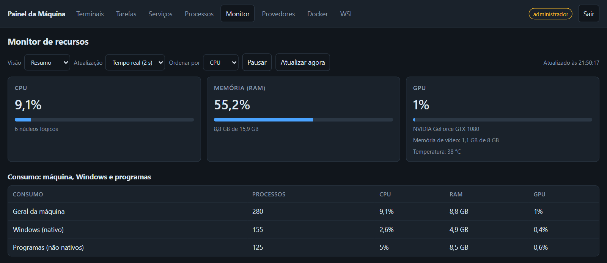
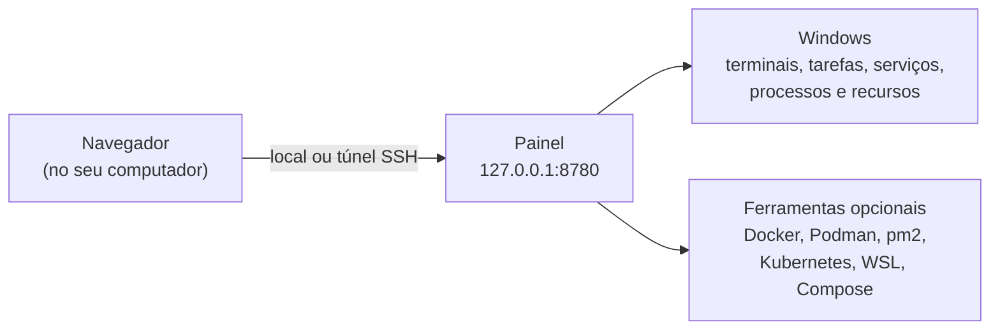
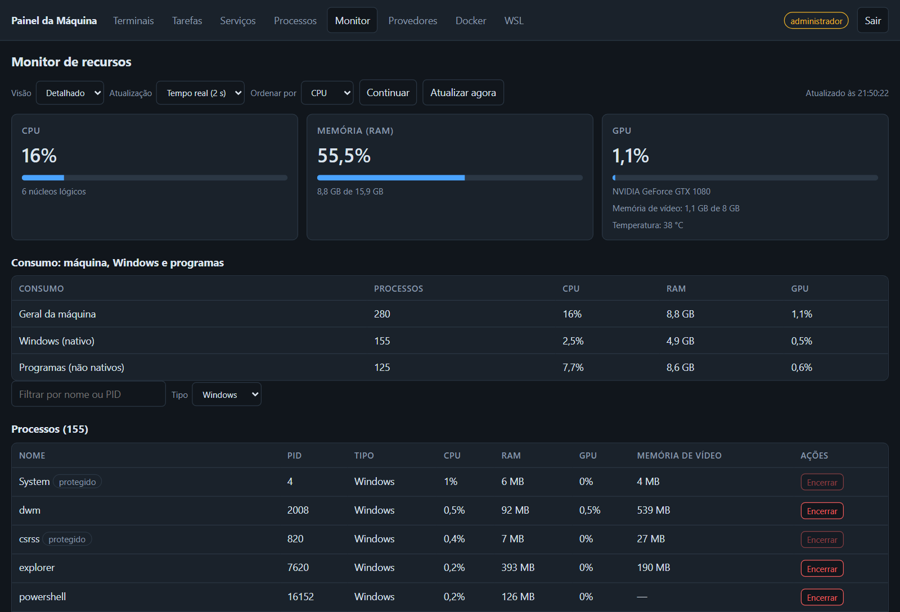
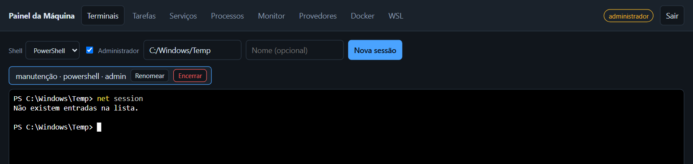
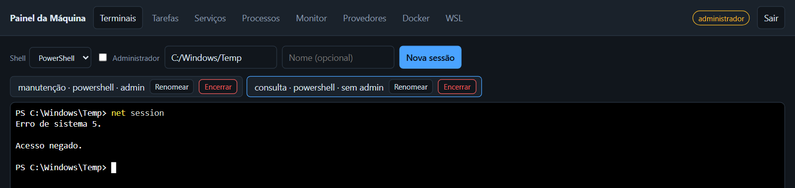
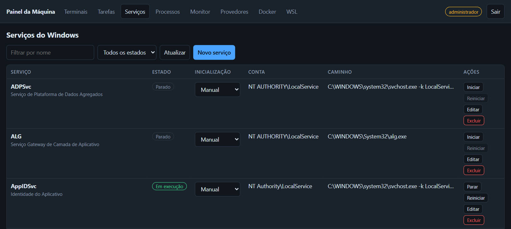
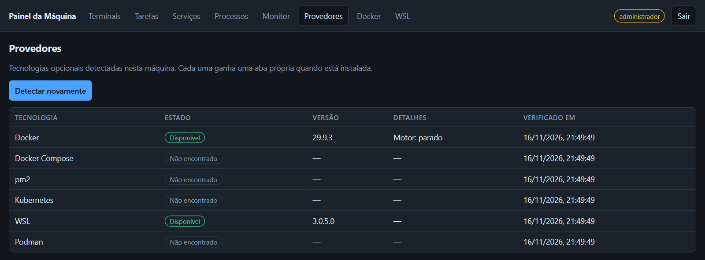
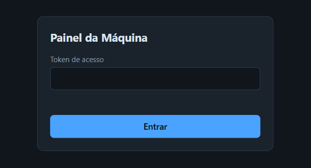

# Painel da Máquina

**Um painel web, só seu, para controlar uma máquina Windows pelo navegador.** Abra terminais (com ou sem administrador), gerencie tarefas agendadas, serviços, processos e containers, e acompanhe CPU, RAM e GPU em tempo real, tudo em um só lugar e sem precisar sentar na máquina.



> **Status:** versão `0.2.0`. Funcionam: login por token, sessões de terminal com ou sem administrador, tarefas agendadas, serviços do Windows, processos e portas, monitor de recursos (CPU, RAM e GPU), Docker, Docker Compose, Podman, pm2, Kubernetes e WSL. A documentação está em [`docs/`](docs/README.md) e o histórico de mudanças no [CHANGELOG](CHANGELOG.md).
>
> **Limitações conhecidas:** somente Windows. Os provedores Docker Compose, Podman, pm2 e Kubernetes foram validados por testes com as ferramentas simuladas; os testes de sistema reais só rodam quando a ferramenta existe na máquina. A interface depende do roteiro de verificação manual em [`tests/e2e/smoke.md`](tests/e2e/smoke.md): execute-o antes de confiar no painel.

> ⚠️ **Aviso de segurança.** Este software dá controle administrativo completo da máquina a quem se autenticar nele. Use apenas em máquinas suas, mantenha o servidor em `127.0.0.1` e acesse remotamente por túnel SSH. Leia [SECURITY.md](SECURITY.md) e [segurança](docs/arquitetura/seguranca.md).

## O que é

O Painel da Máquina é um pequeno servidor (Node.js) que roda **na própria máquina Windows**, como administrador, e mostra uma interface web. Você entra com um token e ganha, no navegador, o que normalmente exigiria vários programas abertos: um PowerShell elevado, o Agendador de Tarefas, o `services.msc`, o Gerenciador de Tarefas, o Docker e outros.

- **Para quem é:** quem administra a própria máquina (um PC de desenvolvimento, um servidor doméstico) e quer acessá-la de outro lugar com segurança.
- **Como se acessa:** pelo próprio computador em `http://127.0.0.1:8780`, ou de outro computador por um túnel SSH. O painel **nunca** é exposto na rede.
- **O que ele não é:** não é multiusuário, não gerencia várias máquinas e não foi feito para ficar na internet.



## Como ele se parece

### Ver o que está pesando na máquina

O **Monitor** mostra o uso de CPU, RAM e GPU e separa o consumo entre o **Windows** (processos nativos) e os **programas** que você instalou. Escolha entre uma visão **resumo** ou **detalhada**, e atualize em tempo real, a cada 30 segundos, 1 minuto ou 5 minutos.



*Visão detalhada: cada processo tem o seu consumo e um botão para encerrar. Processos críticos do Windows aparecem como "protegido" e o painel nunca os encerra.*

### Abrir terminais, com ou sem administrador

Terminais de verdade no navegador (PowerShell, cmd, Git Bash e WSL), que continuam vivos ao fechar a aba. Ao abrir, você escolhe se o terminal tem permissão de administrador. O mesmo comando mostra a diferença:



*Com administrador: o comando funciona.*



*Sem administrador: o mesmo comando recebe "Acesso negado".*

### Gerenciar serviços, tarefas e processos

Liste, inicie, pare, reinicie, crie, edite e exclua **serviços** e **tarefas agendadas**, e veja **processos** e as **portas** em escuta. Ações perigosas pedem confirmação, e excluir exige digitar o nome do item.



### Usar as ferramentas que você já tem

Docker, Docker Compose, Podman, pm2, Kubernetes e WSL ganham uma aba própria **só se estiverem instalados**. O painel detecta sozinho e passa a mostrar a aba quando você instalar uma nova.



### Entrar com um token

O acesso é por um token gerado na sua máquina (só o hash fica em disco), com bloqueio após tentativas erradas e auditoria de tudo que altera algo.



## Funcionalidades

| Área | O que faz |
|---|---|
| Terminais | Abre PowerShell, cmd, Git Bash e WSL no navegador, com ou sem administrador; as sessões continuam vivas ao fechar a aba |
| Tarefas agendadas | Lista, executa, para, ativa, desativa, cria, edita e exclui tarefas |
| Serviços | Lista, inicia, para, reinicia, muda o tipo de inicialização, cria, edita e exclui serviços |
| Docker | Containers (ciclo de vida e logs) e imagens |
| Processos e portas | Mostra quem usa cada porta e encerra processos |
| Monitor de recursos | CPU, RAM e GPU gerais e por processo, separando o Windows dos programas, em resumo ou detalhado, com atualização de tempo real a 5 minutos e encerramento de processos |
| Provedores opcionais | pm2, Kubernetes, Docker Compose, Podman e WSL: a aba só aparece se a ferramenta estiver instalada |
| Segurança | Token (somente hash em disco), bloqueio por tentativas, escuta só em loopback, auditoria, confirmações e recursos protegidos |

## Como funciona

Um servidor Node.js roda na própria máquina (tarefa agendada elevada) e expõe uma interface web em `http://127.0.0.1:8780`. Para acessar de outro computador, use um túnel SSH ([acesso remoto](docs/operacao/acesso-remoto.md)). Para ver o código por dentro, comece pela [visão geral da arquitetura](docs/arquitetura/visao-geral.md).

## Requisitos

- Windows 10 ou 11 (x64)
- Node.js 24 (veja `.nvmrc`)
- Opcionais: Docker (e Compose), pm2, kubectl, Podman, WSL e, para a temperatura da GPU, `nvidia-smi`

## Instalação e uso

Passo a passo na seção [Como executar](#como-executar-how-to-run) logo abaixo. Guia completo, com problemas comuns, em [docs/operacao/instalacao.md](docs/operacao/instalacao.md).

## Como executar (how to run)

### 1. Primeira vez

```powershell
git clone https://github.com/PedroWC/painel-maquina.git painel-maquina
cd painel-maquina
npm ci
npm run gerar-token      # cria o config.json e mostra o token UMA vez: guarde-o em um gerenciador de senhas
```

### 2. Rodar

| Modo | Comando | Quando usar |
|---|---|---|
| **Contínuo e elevado** (recomendado) | `.\scripts\instalar-tarefa.ps1 -IniciarAgora` em um PowerShell **como administrador** | Uso diário: inicia com o Windows, como administrador, sem janela, e volta sozinho se cair |
| **Manual** (teste) | `npm start` em um PowerShell como administrador; pare com `Ctrl+C` | Experimentar ou desenvolver |
| **Segunda instância** (ao lado da contínua) | `$env:PAINEL_PORT = 8791; npm start` | Testar sem mexer na instância em uso; usa o mesmo `config.json` e o mesmo token |

Depois, abra **http://127.0.0.1:8780** e entre com o token. O selo **administrador** no topo confirma que o painel está elevado. Sem privilégio de administrador o painel abre, mas as ações que exigem elevação falham e os terminais abrem sem administrador.

### 3. Acessar de outro computador

O painel só escuta em `127.0.0.1`. Use um túnel SSH e abra `http://127.0.0.1:8780` no computador local ([acesso remoto](docs/operacao/acesso-remoto.md)):

```bash
ssh -L 8780:127.0.0.1:8780 usuario@endereco-da-maquina
```

### 4. Parar, iniciar e reiniciar (modo contínuo)

```powershell
Stop-ScheduledTask  -TaskName PainelMaquina
Start-ScheduledTask -TaskName PainelMaquina
Get-ScheduledTask -TaskName PainelMaquina | Get-ScheduledTaskInfo   # estado e último resultado
Get-Content .\painel.log -Tail 20                                   # o que o painel registrou
```

> Reiniciar o painel **encerra os terminais abertos** (as sessões ficam só em memória).

### 5. Atualizar para uma nova versão

**Pare a tarefa antes de reinstalar as dependências.** Com o painel rodando, o Windows trava o arquivo nativo do `node-pty` e o `npm ci` falha no meio, deixando o `node_modules` incompleto.

```powershell
Stop-ScheduledTask -TaskName PainelMaquina
git pull
npm ci          # só é necessário se o package-lock.json mudou
Start-ScheduledTask -TaskName PainelMaquina
```

Leia o [CHANGELOG](CHANGELOG.md) antes de atualizar. Se uma versão alterar a tarefa, rode `.\scripts\instalar-tarefa.ps1` de novo.

### 6. Configurar

Arquivo `config.json` (não versionado; modelo em `config.example.json`). Reinicie a tarefa depois de editar.

| Campo | Padrão | Para que serve |
|---|---|---|
| `port` | `8780` | Porta do painel |
| `host` | `127.0.0.1` | Endereço de escuta (não mude sem ler [acesso remoto](docs/operacao/acesso-remoto.md)) |
| `allowedHosts` | `[]` | Nomes extras aceitos no cabeçalho `Host` |
| `sessionHours` | `12` | Duração do login |
| `maxTerminals` | `20` | Limite de terminais abertos |
| `pm2Entry` | `""` | Caminho do `bin/pm2`, se o provedor pm2 não o achar sozinho |

Variáveis de ambiente: `PAINEL_HOST` e `PAINEL_PORT` (têm precedência sobre o arquivo), `PAINEL_LOG=0` (desliga o `painel.log`) e `PAINEL_PM2_ENTRY`. Para **trocar o token**, rode `npm run gerar-token` de novo e reinicie.

### 7. Testar e verificar

```powershell
npm run lint        # ESLint
npm test            # testes (simulados; não alteram a máquina)
npm run test:cov    # com cobertura (mínimo de 80% em src/)
```

Antes de confiar numa versão, execute o roteiro manual [`tests/e2e/smoke.md`](tests/e2e/smoke.md). Não rode `npm ci` na pasta com o painel em execução (veja a seção 5).

Problemas comuns e a lista completa de comandos: [instalação e operação](docs/operacao/instalacao.md).

## Documentação

| Assunto | Onde |
|---|---|
| Índice geral | [docs/README.md](docs/README.md) |
| Requisitos e regras | [ERS](docs/requisitos/ers.md) · [regras de negócio](docs/requisitos/regras-de-negocio.md) · [rastreabilidade](docs/requisitos/rastreabilidade.md) |
| Produto | [casos de uso](docs/produto/casos-de-uso.md) · [histórias de usuário](docs/produto/historias-de-usuario.md) · [mapa do site](docs/produto/mapa-do-site.md) · [protótipos](docs/prototipos/README.md) |
| Arquitetura | [visão geral](docs/arquitetura/visao-geral.md) · [segurança](docs/arquitetura/seguranca.md) · [ADRs](docs/arquitetura/adr/README.md) |
| Processo | [git workflow](docs/processo/git-workflow.md) · [nomenclatura](docs/processo/nomenclatura.md) · [versionamento](docs/processo/versionamento.md) · [testes](docs/processo/estrategia-de-testes.md) · [definição de pronto](docs/processo/definicao-de-pronto.md) |

## Contribuindo

Leia [CONTRIBUTING.md](CONTRIBUTING.md). Resumo: branches `tipo/N-slug`, commits em Conventional Commits (PT-BR), testes para cada requisito e documentação atualizada no mesmo PR.

## Versionamento

[SemVer 2.0](https://semver.org/lang/pt-BR/). Histórico de mudanças no [CHANGELOG](CHANGELOG.md).

## Licença

[MIT](LICENSE) © 2026 Pedro Carvalhaes
