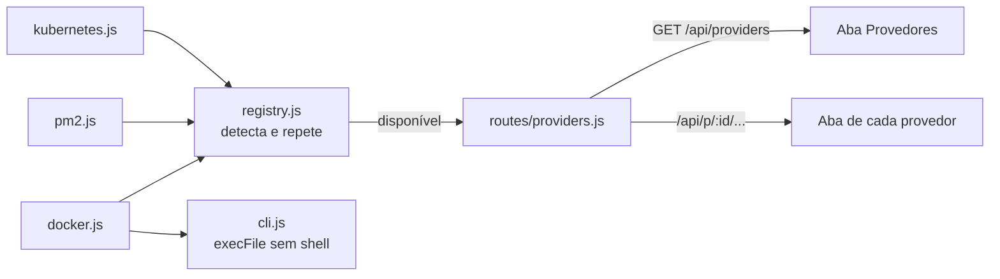

# Provedores

Um **provedor** integra uma tecnologia opcional (Docker, pm2, Kubernetes, Podman, WSL...) ao painel. A decisão está no [ADR 0012](adr/0012-provedores-opcionais-com-deteccao.md); regras em [RN-11 a RN-14](../requisitos/regras-de-negocio.md). Este documento descreve o contrato e como criar um novo provedor.

## Como funciona



1. Na inicialização, e a cada 5 minutos, o `registry` chama `detect()` de cada provedor.
2. `GET /api/providers` informa o status; a interface cria uma aba para cada provedor **disponível** e remove as dos que deixaram de estar.
3. As rotas `/api/p/:id/...` só existem para provedores disponíveis; para os demais respondem **404** ([RN-11](../requisitos/regras-de-negocio.md#rn-11)).
4. Cada chamada tem tempo limite e o erro de um provedor fica restrito à requisição dele ([RN-14](../requisitos/regras-de-negocio.md#rn-14)).

## Contrato (`src/providers/base.js`)

```js
defineProvider({
  id: 'meu-provedor',            // minúsculas, números e hífen (até 20)
  nome: 'Meu provedor',          // texto da aba
  confirmaPorNome: false,        // true: toda ação destrutiva exige digitar o nome (ex.: Kubernetes)
  timeoutMs: 20000,              // opcional: limite de cada chamada

  async detect() {               // => { disponivel, versao?, info? }
    // ferramenta ausente: devolva { disponivel: false } (não lance erro)
  },

  async list() {                 // => { sections, contexto? }
    return {
      contexto: 'Contexto: dev · Namespace: padrao',   // opcional, vira um banner
      sections: [{
        id: 'itens',
        title: 'Itens',
        empty: 'Nenhum item.',
        columns: [{ key: 'nome', title: 'Nome' }],
        rows: [{
          id: 'identificador-seguro',                  // vai para as ações e os logs
          cells: { nome: 'um' },                       // uma chave por coluna
          status: { texto: 'Em execução', tom: 'ok' }, // opcional: ok | off | mau
          actions: ['restart', 'delete'],              // operações aplicáveis a esta linha
          logs: true,                                  // mostra o botão Logs
        }],
      }],
    };
  },

  actions: {                     // allowlist de operações (RN-12)
    restart: { rotulo: 'Reiniciar', destrutiva: false, run: async (id, params) => {} },
    scale: {
      rotulo: 'Escalar',
      destrutiva: true,
      confirmarNome: true,       // exige digitar o nome do recurso
      validar: (params) => ({ replicas: params.replicas }),  // devolve os parâmetros já validados
      run: async (id, params) => {},
    },
  },

  async logs(id) {},             // opcional => texto
  validateId(id) {},             // opcional; o padrão aceita só ids seguros
});
```

## Regras que todo provedor precisa seguir

| Regra | O que fazer |
|---|---|
| RN-12 | Chamar **apenas o próprio executável**, por `cli.run(exe, [args...])` (`execFile`, sem shell). Nunca montar comando por concatenação. |
| RN-12 | Todo `id` recebido passa por `validateId`. O padrão (`SAFE_ID`) exige primeiro caractere alfanumérico, o que impede que um identificador vire uma opção (`-f`, `--all`). |
| RN-11 | `detect()` devolve `{ disponivel: false }` quando a ferramenta não existe; o erro 404 do `cli.run` indica isso. |
| RN-05 | Marque como `destrutiva: true` tudo que exclui, remove ou para. A interface pede confirmação; o servidor impõe a digitação do nome quando `confirmarNome`/`confirmaPorNome`. |
| RN-13 | Provedores que operam em clusters mostram o contexto (`contexto`) e usam `confirmaPorNome: true`. |
| RN-14 | Erros esperados devem ser `HttpError` com mensagem amigável (por exemplo, 503 "motor parado"). Erros inesperados viram 502 genérico, sem expor detalhes internos. |
| RN-17 | Parâmetros além do `id` (por exemplo, número de réplicas) são validados em `validar`. |
| Privacidade | Não devolva nem registre segredos. Os registros de auditoria guardam só provedor, operação, id e resultado. |

## Como criar um provedor (passo a passo)

1. **Documente primeiro:** crie o RF no [ERS](../requisitos/ers.md), o caso de uso e a história; atualize [rastreabilidade](../requisitos/rastreabilidade.md).
2. Crie `src/providers/<id>.js` com `createXxxProvider({ cli })` seguindo o contrato.
3. Registre-o em `src/main.js`, na lista `providers` do `createRegistry`.
4. Escreva os testes em `tests/unit/providers/<id>.test.js` usando `tests/helpers/fake-cli.js`. Cubra: detecção (presente, ausente, motor/serviço parado), listagem, **argumentos exatos de cada ação**, ações destrutivas, logs e mensagens de erro.
5. Se a ferramenta existir na máquina de desenvolvimento, adicione um teste `*.windows.test.js` **somente leitura** (nunca altere recursos que o teste não criou).
6. Atualize o [CHANGELOG](../../CHANGELOG.md) e, se mudar algo visível, os [protótipos](../prototipos/README.md).

A interface **não precisa mudar**: a aba é montada a partir do que o provedor devolve.

## Observação sobre executáveis `.cmd` no Windows

Ferramentas instaladas por npm (como o pm2) são scripts `.cmd`, e o Node recusa executar `.cmd` com `execFile` sem shell. O provedor correspondente deve resolver o executável real (por exemplo, o `node` mais o script de entrada) em vez de ativar `shell: true`. Isso será tratado no provedor pm2.
