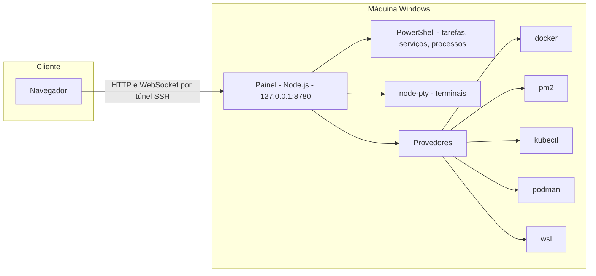
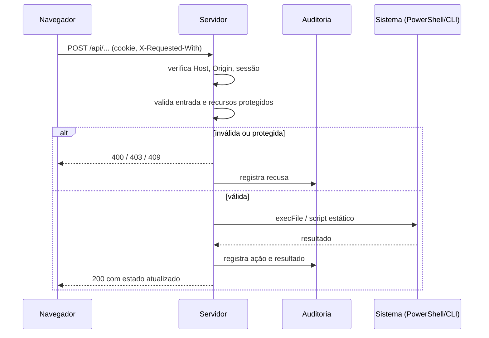

# Visão geral da arquitetura

Decisões que sustentam esta arquitetura estão nos [ADRs](adr/README.md). Requisitos em [ERS](../requisitos/ers.md).

## Contexto



O navegador conversa com o painel por HTTP (API JSON) e WebSocket (terminais). O painel executa tudo localmente, com o privilégio do processo.

## Componentes

| Módulo | Responsabilidade |
|---|---|
| `src/main.js` | Ponto de entrada: carrega a configuração, monta as dependências e inicia o servidor |
| `src/server.js` | Servidor HTTP, borda de segurança, sessão, lista de rotas injetável e arquivos estáticos (WebSocket entra com os terminais) |
| `src/security.js` | Verificação de `Host` e `Origin`, cookies e cabeçalhos de segurança |
| `src/system.js` | Detecção de privilégio de administrador |
| `src/config.js` | Leitura e validação da configuração (host, porta, hash do token, `allowedHosts`) |
| `src/auth.js` | Geração e hash do token, login, sessões e bloqueio por tentativas |
| `src/audit.js` | Registro de auditoria em JSON Lines |
| `src/validate.js` | Validação de entradas e allowlists |
| `src/powershell.js` | Execução de scripts PowerShell estáticos com parâmetros por ambiente ([ADR 0006](adr/0006-powershell-com-parametros-por-ambiente.md)) |
| `src/protections.js` | Recursos protegidos: tarefa e processo do painel, serviços críticos |
| `src/terminals.js` | Gerenciador de sessões de terminal (node-pty injetável), histórico, limite e PIDs protegidos |
| `src/routes/terminals.js` | Rotas HTTP e WebSocket dos terminais |
| `src/routes/tasks.js` · `services.js` · `processes.js` | Tarefas agendadas, serviços, processos e portas |
| `src/routes/providers.js` | Status e recursos dos provedores |
| `src/providers/` | Contrato (`base.js`), detecção (`registry.js`) e provedores: docker, compose, pm2, kubernetes, podman, wsl |
| `public/` | Interface (HTML, CSS e JS puros) |
| `scripts/` | Geração de token e instalação da tarefa elevada |

## Contrato dos provedores

```js
// src/providers/base.js (resumo)
{
  id: 'pm2',
  nome: 'pm2',
  async detect() { return { disponivel: true, versao: '5.x' } },
  async list() { /* recursos normalizados */ },
  actions: {
    restart: { destrutiva: false, run: async (id) => {} },
    delete:  { destrutiva: true,  run: async (id) => {} },
  },
  async logs(id, opcoes) { /* texto */ },
}
```

O `registry.js` guarda o resultado da detecção, repete-o periodicamente e expõe `GET /api/providers`. Chamadas a provedores têm tempo limite e erros isolados ([RN-14](../requisitos/regras-de-negocio.md#rn-14)).

## Fluxo de uma ação que altera estado



## Configuração

Arquivo `config.json` na raiz (não versionado). Modelo em `config.example.json`.

| Campo | Padrão | Descrição |
|---|---|---|
| `host` | `127.0.0.1` | Endereço de escuta ([RN-10](../requisitos/regras-de-negocio.md#rn-10)) |
| `port` | `8780` | Porta |
| `tokenHash` | gerado | Hash scrypt do token ([RN-16](../requisitos/regras-de-negocio.md#rn-16)) |
| `allowedHosts` | `[]` | Hosts adicionais aceitos no cabeçalho `Host` |
| `sessionHours` | `12` | Duração da sessão ([RN-02](../requisitos/regras-de-negocio.md#rn-02)) |
| `maxTerminals` | `20` | Limite de sessões de terminal ([RN-15](../requisitos/regras-de-negocio.md#rn-15)) |

Variáveis de ambiente `PAINEL_HOST` e `PAINEL_PORT` têm precedência sobre o arquivo.

## Dados e persistência

Sem banco de dados. Sessões web e sessões de terminal ficam em memória e se perdem ao reiniciar. Persistem: `config.json` e `audit.log`.

## Implantação

Tarefa agendada `PainelMaquina` (S4U, nível mais alto, na inicialização) instalada por `scripts/instalar-tarefa.ps1` ([ADR 0007](adr/0007-execucao-elevada-via-agendador.md)). Veja [instalação](../operacao/instalacao.md).
