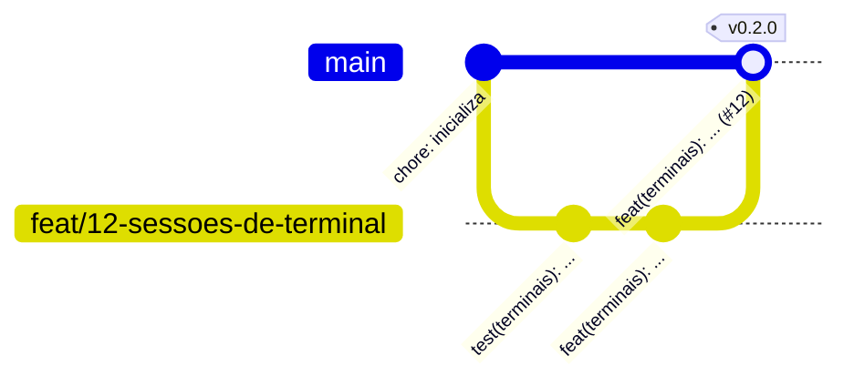

# Fluxo de trabalho com Git

Decisão registrada no [ADR 0008](../arquitetura/adr/0008-github-flow-conventional-commits-semver.md). Nomes de branches e commits em [nomenclatura](nomenclatura.md).

## Resumo

- `main` é protegida e sempre estável. **Ninguém commita direto nela.**
- Toda melhoria ou correção nasce em uma branch curta a partir da `main` atualizada.
- A integração é feita por Pull Request com **squash merge**; o título do PR vira o commit na `main`.
- Releases são tags `vX.Y.Z` na `main` ([versionamento](versionamento.md)).



## Passo a passo

1. **Issue.** Toda mudança tem uma issue (ou um número de referência) descrevendo o problema e os IDs afetados (`RF-`, `RN-`).
2. **Branch.**
   ```
   git switch main
   git pull --ff-only
   git switch -c feat/12-sessoes-de-terminal
   ```
3. **Documentar primeiro.** Atualize requisitos, regras, casos de uso, histórias, mapa do site e protótipos. Decisão arquitetural nova gera um [ADR](../arquitetura/adr/README.md).
4. **Testes e código.** Escreva os testes (com o ID no nome) e depois a implementação.
5. **Verificar localmente:** `npm run lint` e `npm test`.
6. **Commits pequenos e coesos**, no padrão Conventional Commits.
7. **Pull Request** para a `main`, usando o modelo em `.github/PULL_REQUEST_TEMPLATE.md`. O CI precisa passar (lint, testes, varredura de segredos, `npm audit`).
8. **Squash merge** e remoção da branch.

## Proteção da `main` (configurada no GitHub)

- Pull Request obrigatório antes de integrar, sem exigir aprovações (o projeto tem um só mantenedor).
- O CI precisa passar: `Lint, testes e auditoria`, `Varredura de segredos` e `Título do PR (Conventional Commits)`.
- A branch precisa estar atualizada com a `main`.
- Push forçado e exclusão da branch bloqueados.
- Histórico linear (somente squash ou rebase; commit de merge não entra na `main`).
- **Administradores não são obrigados** a seguir essas regras (a opção "Do not allow bypassing" está desligada), para que o mantenedor consiga agir numa emergência. Mesmo assim, o fluxo normal é sempre por PR.

Os alertas de vulnerabilidade do Dependabot também estão ativados.

## Commits

Formato: `tipo(escopo): descrição` em PT-BR, no imperativo, até 100 caracteres. Veja exemplos e tipos em [nomenclatura](nomenclatura.md). Corpo opcional explica o porquê. Rodapé opcional: `Refs: #12`. Mudança incompatível: `!` após o escopo e `BREAKING CHANGE:` no rodapé.

## Correções urgentes (`hotfix/`)

Para um defeito grave em versão já lançada: `hotfix/N-slug` a partir da `main`, correção mínima com teste (ou, se for só de documentação, a correção e a verificação dos links), PR com prioridade e CHANGELOG em `[Não lançado]`. A correção só vira uma versão PATCH quando o mantenedor pedir uma release; integrar o PR não cria tag.

## PRs empilhados

Quando um PR depende de outro ainda aberto, a base dele é a branch do primeiro. Dois cuidados:

- O CI só roda em PRs cuja base é a `main`: mudar a base de um PR para a `main` **não** dispara o CI; é preciso um push novo.
- Se o primeiro PR for integrado por **squash**, os commits originais não existem na `main` e o segundo PR passa a ter conflitos de texto. Integre o primeiro com **commit de merge**, ou atualize a branch do segundo com `git merge -X ours origin/main` e confira que a árvore ficou idêntica antes de enviar.

## Dados sensíveis

Antes de abrir PR, revise `git diff --staged`: nada de `config.json`, tokens, `audit.log`, caminhos de usuário, IPs reais ou e-mails pessoais. O repositório usa identidade de autor configurada localmente ([ADR 0009](../arquitetura/adr/0009-higiene-de-segredos-e-metadados.md)).
