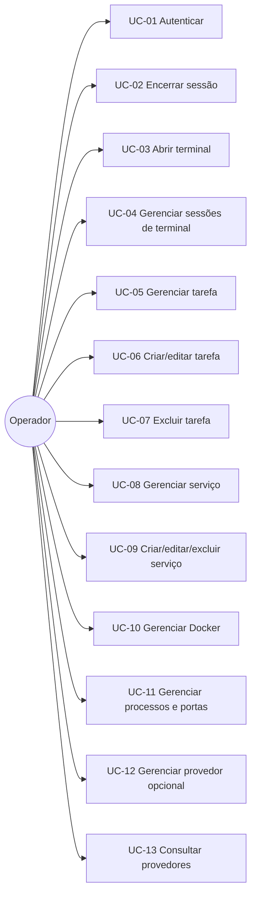

# Casos de uso

**Ator principal:** Operador (administrador da máquina, autenticado). Pré-condição geral, salvo UC-01: o operador está autenticado ([UC-01](#uc-01)). Requisitos em [ERS](../requisitos/ers.md); regras em [regras de negócio](../requisitos/regras-de-negocio.md).

## UC-01 · Autenticar

- **Requisitos:** RF-01 · **Regras:** RN-01, RN-16
- **Fluxo principal:** 1) O operador abre o painel. 2) O sistema exibe a tela de login. 3) O operador informa o token. 4) O sistema valida, cria a sessão e abre o painel.
- **Alternativo A (token inválido):** no passo 4 o sistema recusa, informa "token inválido" e conta a falha.
- **Exceção (bloqueio):** após 5 falhas seguidas ([RN-01](../requisitos/regras-de-negocio.md#rn-01)), o sistema informa o bloqueio e o tempo restante.
- **Pós-condição:** sessão ativa por até 12 h; login registrado na auditoria.

## UC-02 · Encerrar sessão

- **Requisitos:** RF-02 · **Regras:** RN-02
- **Fluxo principal:** 1) O operador escolhe "Sair". 2) O sistema invalida a sessão e volta ao login.
- **Alternativo (expiração):** após 12 h a próxima requisição recebe 401 e o painel volta ao login.
- **Pós-condição:** cookie de sessão inválido.

## UC-03 · Abrir terminal

- **Requisitos:** RF-03 · **Regras:** RN-07, RN-15, RN-17
- **Fluxo principal:** 1) Na aba Terminais, o operador escolhe shell, pasta e nome. 2) Confirma. 3) O sistema cria a sessão com privilégio de administrador, marcada como "admin". 4) O terminal abre pronto para digitar.
- **Alternativo A (pasta inexistente):** o sistema usa a pasta padrão do usuário e informa.
- **Exceção A (limite):** com 20 sessões abertas, o sistema recusa e pede para encerrar alguma.
- **Exceção B (shell indisponível):** Git Bash ou WSL ausentes não aparecem como opção.
- **Pós-condição:** sessão viva até o operador encerrar ou o shell sair.

## UC-04 · Gerenciar sessões de terminal

- **Requisitos:** RF-04, RF-05, RF-06 · **Regras:** RN-15, RN-05
- **Fluxo principal (reanexar):** 1) O operador abre a aba Terminais. 2) O sistema lista as sessões. 3) O operador seleciona uma. 4) O sistema reconecta e reexibe o histórico recente.
- **Alternativo A (renomear):** o operador edita o nome da sessão.
- **Alternativo B (encerrar):** o operador encerra a sessão; o sistema pede confirmação, encerra o shell e a remove da lista.
- **Alternativo C (sessão já finalizada):** o sistema mostra o histórico e o código de saída; só permite remover.

## UC-05 · Gerenciar tarefa agendada

- **Requisitos:** RF-07, RF-08, RF-09, RF-25 · **Regras:** RN-03, RN-08, RN-06
- **Fluxo principal:** 1) O operador abre a aba Tarefas. 2) O sistema lista tarefas (sem as de `\Microsoft\`). 3) O operador filtra e escolhe uma ação: executar, parar, ativar ou desativar. 4) O sistema executa e atualiza a linha.
- **Alternativo A:** "Mostrar tarefas do Windows" inclui as de `\Microsoft\`.
- **Exceção A (tarefa protegida):** para a tarefa do painel, parar e desativar são recusados ([RN-03](../requisitos/regras-de-negocio.md#rn-03)).
- **Exceção B (tarefa desativada):** executar uma tarefa desativada é recusado com a orientação de ativá-la antes.
- **Pós-condição:** ação registrada na auditoria.

## UC-06 · Criar ou editar tarefa

- **Requisitos:** RF-10 · **Regras:** RN-03, RN-17
- **Fluxo principal:** 1) O operador escolhe "Nova tarefa" (ou "Editar"). 2) Informa nome, comando, argumentos, pasta, gatilho (diário, semanal, no logon, na inicialização, uma vez ou manual) e conta (sistema ou usuário). 3) Confirma. 4) O sistema cria ou altera a tarefa e atualiza a lista.
- **Exceção A (dados inválidos):** o sistema aponta o campo com problema.
- **Exceção B (nome já existe, na criação):** o sistema pergunta se deseja substituir.
- **Exceção C (tarefa protegida):** edição da tarefa do painel é recusada.

## UC-07 · Excluir tarefa

- **Requisitos:** RF-10, RF-27 · **Regras:** RN-03, RN-05
- **Fluxo principal:** 1) O operador escolhe "Excluir". 2) O sistema exige digitar o nome da tarefa. 3) O operador confirma. 4) O sistema exclui e registra.
- **Exceção:** a tarefa do painel não pode ser excluída.

## UC-08 · Gerenciar serviço

- **Requisitos:** RF-11, RF-12, RF-13, RF-25 · **Regras:** RN-09, RN-05
- **Fluxo principal:** 1) O operador abre a aba Serviços. 2) Filtra por nome ou estado. 3) Escolhe iniciar, parar, reiniciar ou mudar o tipo de inicialização. 4) O sistema aplica e atualiza o estado.
- **Alternativo (confirmação reforçada):** parar, reiniciar ou desativar o `sshd` exige digitar o nome do serviço, por ser o canal de acesso remoto; o servidor impõe a regra e a interface apenas abre o diálogo quando solicitada.
- **Exceção:** serviços críticos do Windows não aceitam parar nem desativar ([RN-09](../requisitos/regras-de-negocio.md#rn-09)).

## UC-09 · Criar, editar e excluir serviço

- **Requisitos:** RF-14 · **Regras:** RN-09, RN-05, RN-17
- **Fluxo principal:** 1) O operador escolhe "Novo serviço", informa nome, executável, nome de exibição, descrição e tipo de inicialização. 2) O sistema cria. Para editar, altera os campos do serviço; para excluir, digita o nome do serviço e confirma.
- **Exceção:** serviços críticos não podem ser editados nem excluídos.

## UC-10 · Gerenciar Docker

- **Requisitos:** RF-15, RF-16 · **Regras:** RN-11, RN-12, RN-05
- **Fluxo principal:** 1) O operador abre a aba Docker. 2) O sistema lista containers e imagens. 3) O operador inicia, para, reinicia, remove ou abre os logs de um container; ou remove uma imagem.
- **Exceção A (Docker parado):** o sistema informa que o motor não está respondendo.
- **Exceção B (Docker ausente):** a aba não existe ([RN-11](../requisitos/regras-de-negocio.md#rn-11)).

## UC-11 · Gerenciar processos e portas

- **Requisitos:** RF-17, RF-25 · **Regras:** RN-04, RN-05
- **Fluxo principal:** 1) O operador abre a aba Processos. 2) O sistema lista processos (por uso de memória) e portas em escuta, com o processo dono. 3) O operador escolhe encerrar um processo e confirma.
- **Exceção:** o processo do painel e os de seus terminais não podem ser encerrados por esta aba.

## UC-12 · Gerenciar provedor opcional

- **Requisitos:** RF-18 a RF-22 · **Regras:** RN-11, RN-12, RN-13, RN-14, RN-05
- **Fluxo principal:** 1) O operador abre a aba de um provedor detectado (Compose, pm2, Kubernetes, Podman, WSL ou outro). 2) O sistema lista os recursos. 3) O operador executa uma ação permitida (iniciar, parar, reiniciar, remover, escalar, ver logs). 4) O sistema aplica e atualiza.
- **Alternativo (Kubernetes):** o contexto e o namespace aparecem no topo; ações destrutivas exigem digitar o nome do recurso.
- **Exceção (falha ou tempo esgotado):** a aba mostra o erro; as demais abas continuam funcionando ([RN-14](../requisitos/regras-de-negocio.md#rn-14)).

## UC-13 · Consultar provedores

- **Requisitos:** RF-23 · **Regras:** RN-11
- **Fluxo principal:** 1) O operador abre "Provedores". 2) O sistema mostra cada tecnologia conhecida como disponível (com versão) ou não encontrada. 3) O operador pode forçar nova detecção.
- **Pós-condição:** abas dos provedores disponíveis refletem o resultado.
