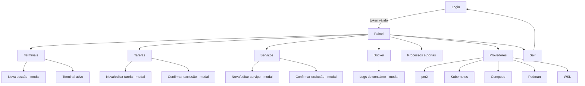

# Mapa do site

O painel é uma aplicação de página única (`/`) com abas. As abas de provedores são geradas dinamicamente a partir da detecção ([RN-11](../requisitos/regras-de-negocio.md#rn-11)). Protótipos de cada tela em [`../prototipos/`](../prototipos/README.md).

## Telas e abas

| Tela | Rota (hash) | Requisitos | Protótipo |
|---|---|---|---|
| Login | `#/login` | RF-01 | [login](../prototipos/login.html) |
| Terminais | `#/terminais` | RF-03 a RF-06 | [terminais](../prototipos/terminais.html) |
| Tarefas | `#/tarefas` | RF-07 a RF-10 | [tarefas](../prototipos/tarefas.html) |
| Serviços | `#/servicos` | RF-11 a RF-14 | [servicos](../prototipos/servicos.html) |
| Docker | `#/docker` | RF-15, RF-16 | [docker](../prototipos/docker.html) |
| Processos e portas | `#/processos` | RF-17 | [processos](../prototipos/processos.html) |
| Provedores (status) | `#/provedores` | RF-23 | [provedores](../prototipos/provedores.html) |
| pm2, Kubernetes, Compose, Podman, WSL | `#/p/<id>` | RF-18 a RF-22 | mesmo padrão da aba Docker |

## Rotas da API

Todas exigem sessão, exceto o login. Rotas que alteram estado exigem o cabeçalho `X-Requested-With: painel` e `Origin` coerente ([segurança](../arquitetura/seguranca.md)).

| Método e caminho | Função | Requisito |
|---|---|---|
| `POST /api/login` · `POST /api/logout` · `GET /api/me` | Sessão | RF-01, RF-02 |
| `GET/POST /api/terminals` · `DELETE /api/terminals/:id` · `POST /api/terminals/:id/rename` | Terminais | RF-03 a RF-06 |
| `WS /ws/term?id=` | Fluxo do terminal | RF-03, RF-05 |
| `GET/POST/PUT /api/tasks` · `POST /api/tasks/action` | Tarefas | RF-07 a RF-10 |
| `GET/POST/PUT /api/services` · `POST /api/services/action` | Serviços | RF-11 a RF-14 |
| `GET /api/processes` · `POST /api/processes/kill` | Processos e portas | RF-17 |
| `GET /api/providers` · `POST /api/providers/refresh` | Status dos provedores | RF-23 |
| `GET /api/p/:id/items` · `POST /api/p/:id/action` · `GET /api/p/:id/logs` | Recursos de cada provedor (inclui Docker) | RF-15, RF-16, RF-18 a RF-22 |
